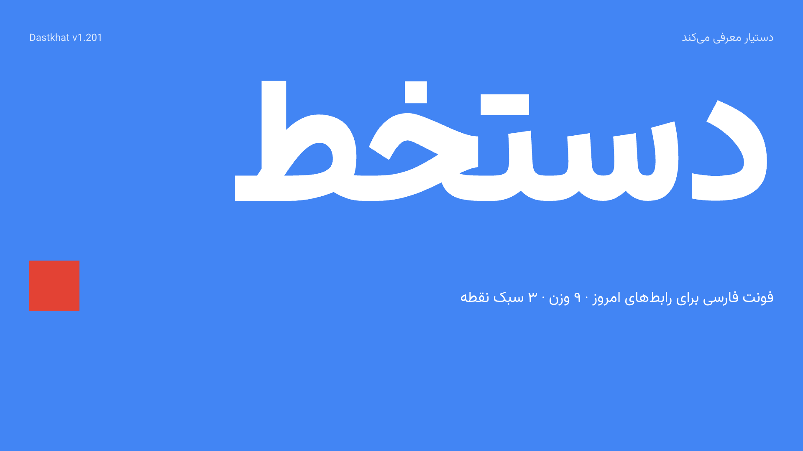
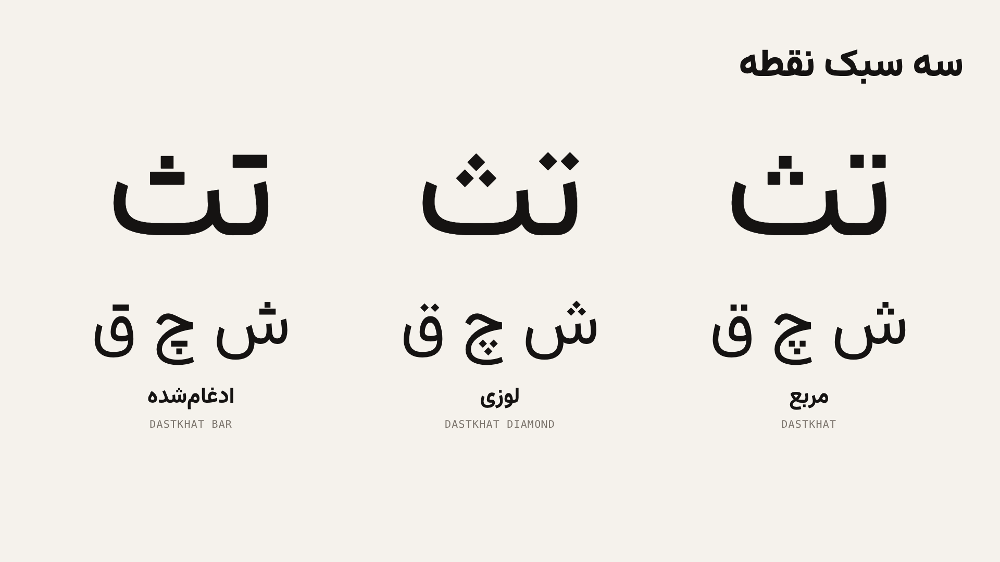
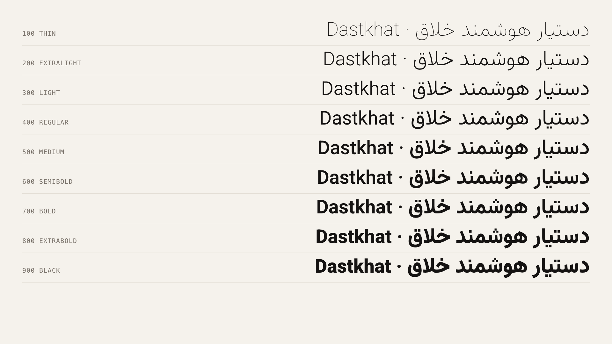
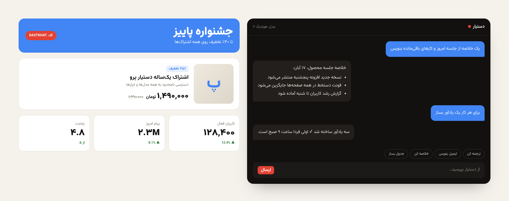

<div align="center">




# Dastkhat (دستخط)

**A Persian and Latin UI typeface with geometric dots.**

[](FONTLOG.txt)
[](OFL.txt)
[](#whats-in-the-package)

[فارسی](README.md) · **English**

</div>

---

Dastkhat is built for product interfaces, e-commerce pages and dense Persian text on screens. It comes in 9 weights (Thin 100 to Black 900) plus a variable font, in three dot styles, with FaNum and NoEn builds for common real-world setups.

It is published by [Dastyar](https://dastyar.io) and is a derivative of [Vazirmatn](https://github.com/rastikerdar/vazirmatn).

## Contents

- [Quick start](#quick-start)
- [Which one should I use?](#which-one-should-i-use)
- [What's in the package](#whats-in-the-package)
- [Installation](#installation)
- [Usage on the web](#usage-on-the-web)
- [Typography tips](#typography-tips)
- [License](#license)
- [Credits](#credits)

## Quick start

For a website, copy the `Webfonts` folder into your project and add three lines:

```html
<link rel="stylesheet" href="/Webfonts/dastkhat.css">
<style>
  body { font-family: var(--font-dastkhat); }
</style>
```

For a design tool such as Figma, Photoshop or Illustrator, install the TTF files from `fonts/Main/Dastkhat/TTF`. See [Installation](#installation).

## Which one should I use?

### Dot styles

| Family | Dots | Best for |
|---|---|---|
| **Dastkhat** | Square | Default for interfaces and body text |
| **Dastkhat Diamond** | Square rotated 45° | A softer, more classic look |
| **Dastkhat Bar** | Two dots merge into a bar, three into a bar and a square | Logos, headlines and brand marks |
| **Dastkhat Dots** | Circle | The same geometry with a softer, rounder texture |
| **Dastkhat BarDots** | Two dots merge into a capsule, three into a capsule and a circle | Rounded logos and headlines |



### Dastkhat Arabic

For readers of Arabic only, **Dastkhat Arabic** is the main Dastkhat family without the Persian-only letters (پ چ ژ گ ک ی) and Persian digits `۰-۹`. The Arabic kaf `ك` and yeh `ي` stay. It comes in three builds: `Dastkhat Arabic`, `Dastkhat Arabic ArNum` (Latin digits `0-9` display as Arabic-Indic digits `٠-٩`) and `Dastkhat Arabic NoEn` (no Latin letters). Files are in `fonts/Main/DastkhatArabic`, `fonts/ArNum/DastkhatArabicArNum` and `fonts/NoEn/DastkhatArabicNoEn`. On the web, load `Webfonts/dastkhat-arabic.css`. For Persian, use the regular families.

### Builds

Every family is available in three builds.

| Build | What changes | Use it when |
|---|---|---|
| **Main** | Full Persian and Latin | Most projects |
| **FaNum** | Latin digits `0-9` display as Persian digits `۰-۹` | Prices, tables and dashboards. Your data and code stay unchanged. |
| **NoEn** | Latin letters removed | You want to pair Dastkhat with your own Latin font, such as Inter or Geist |

### Static or variable?

| Need | Use |
|---|---|
| Precise control over each weight in design tools | `fonts/Main/<Family>/TTF` (9 weights) |
| Smaller files, every weight from 100 to 900 in one file | `fonts/Main/<Family>/Variable` |
| Websites and web apps | `Webfonts/` (WOFF2) |

## What's in the package

```
Dastkhat-v1.210/
├── fonts/
│   ├── Main/      Dastkhat, DastkhatDiamond, DastkhatBar,
│   │              DastkhatDots, DastkhatBarDots           (TTF ×9 + Variable)
│   ├── FaNum/     Same families, Latin digits shown as Persian digits
│   └── NoEn/      Same families, Persian only
├── Webfonts/      dastkhat.css, fonts/*.woff2, webfont-test.html
├── Specimen/      Dastkhat-Specimen.pdf
├── Demos/         Font page, type tester, glyph map, UI demos, images
├── Helps/         Installation and usage guide (Persian and English)
├── OFL.txt        SIL Open Font License 1.1
├── License/       Third-party notices
├── sources/       UFO + designspace sources (ufo/), build scripts
├── GoogleFonts/   Metadata for the Google Fonts submission
├── docs/          Publishing and Google Fonts guides
├── FONTLOG.txt    Change history
├── README.md      Persian version of this file
└── README.en.md   This file
```

## Installation

> [!IMPORTANT]
> On one computer, install **either** the static fonts **or** the variable font, never both. Identical family names cause conflicts in many apps.

### Windows

1. Open `fonts/Main/Dastkhat/TTF`.
2. Select all files (`Ctrl+A`), right-click and choose **Install for all users**.
3. Restart your design software.

### macOS

1. Open **Font Book**.
2. Drag the TTF files into the window.
3. If you see a duplicate warning, remove the previous Dastkhat version first.

### Linux

```bash
mkdir -p ~/.local/share/fonts/Dastkhat
cp fonts/Main/Dastkhat/TTF/*.ttf ~/.local/share/fonts/Dastkhat/
fc-cache -f
```

## Usage on the web

### Plain CSS

The stylesheet defines one variable per family:

```css
body    { font-family: var(--font-dastkhat); }                         /* square dots */
.price  { font-family: var(--font-dastkhat-fanum); }                   /* Persian digits */
.logo   { font-family: var(--font-dastkhat-bar); font-weight: 900; }   /* merged dots */
```

| Variable | Family |
|---|---|
| `--font-dastkhat` | Dastkhat |
| `--font-dastkhat-diamond` | Dastkhat Diamond |
| `--font-dastkhat-bar` | Dastkhat Bar |
| `--font-dastkhat-dots` | Dastkhat Dots |
| `--font-dastkhat-bardots` | Dastkhat BarDots |
| `--font-dastkhat-fanum` | Dastkhat FaNum |

The variable families are named `Dastkhat`, `Dastkhat Diamond`, `Dastkhat Bar`, `Dastkhat Dots` and `Dastkhat BarDots` (add ` FaNum` or ` NoEn` for the other builds). The static fallbacks use the same names with ` Static` added. All `@font-face` rules use `font-display: swap`.

### With a separate Latin font (NoEn)

```css
body { font-family: 'Dastkhat NoEn', 'Inter', sans-serif; }
```

The browser finds no Latin letters in Dastkhat NoEn and falls through to Inter for English text.

### Next.js

```js
import localFont from 'next/font/local'

export const dastkhat = localFont({
  src: './Dastkhat-Variable.woff2',
  weight: '100 900',
  variable: '--font-dastkhat',
  display: 'swap',
})
```

### Tailwind CSS

Set `fontFamily.sans` to `var(--font-dastkhat)` in your Tailwind config.

### Right-to-left pages

Set the direction and language on the document so punctuation and numbers behave correctly:

```html
<html lang="fa" dir="rtl">
```

### Performance

- Prefer the variable WOFF2 when you use three or more weights.
- Preload only the file used above the fold:
  ```html
  <link rel="preload" href="/Webfonts/fonts/Dastkhat-Variable.woff2" as="font" type="font/woff2" crossorigin>
  ```
- Self-host the files. Do not rely on a third-party CDN for fonts.

Open `Webfonts/webfont-test.html` in a browser to confirm everything loads.

## Typography tips

| Element | Recommendation |
|---|---|
| Body text | 15 to 18 px, line height 1.8 to 2 |
| Headings | Weight 700 to 900, line height 1.2 to 1.3 |
| Prices and tables | Use the FaNum build |
| Persian text | **Do not use `letter-spacing`.** It breaks the joining of letters. |

Persian needs more line height than Latin because of its tall ascenders and stacked dots. If your text looks cramped, increase line height before reducing font size.

### Currency signs

Persian has a standard rial sign, `﷼` (U+FDFC), but the toman has no Unicode code point at all: the Unicode Technical Committee rejected the 2017 proposal because the word was always spelled out and no sign was actually in use. Dastkhat therefore adds three signs of its own in the Private Use Area, in every family and every weight.

| Sign | Code point | Shape |
|---|---|---|
| Rial | `U+FDFC` ﷼ | The standard sign: the word «ریال» as one glyph. Unchanged. |
| Toman | `U+E000` | «ت» whose two dots stretch into two bars, the "=" of ₹ € ¥. Dastkhat Bar already merges dots into bars; here they become a currency sign. |
| Rial, compact | `U+E001` | «ا» and «ل» as two stems, crossed by «ر». The word reduced to its strokes, the same reading as the Saudi riyal sign. |
| Toman, stacked | `U+E002` | «ن» stacked over «توما», the toman icon Iranian sites already use, in Dastkhat letters. The counterpart of ﷼. |

Two opt-in OpenType features turn the typed words into the signs, so you keep writing «تومان» and «ریال» in your content and markup. `ss02` is the same stylistic set other Persian fonts, such as Ravi and Abar, use for their currency signs.

```css
.price      { font-feature-settings: 'ss02'; }   /* تومان and ریال become the compact signs */
.price-long { font-feature-settings: 'ss03'; }   /* تومان becomes the stacked sign, ریال becomes ﷼ */
```

Neither feature is on by default, so the words stay words everywhere else. Only the currency word is replaced; the amount beside it is untouched.

> [!NOTE]
> The compact signs live in the Private Use Area, which means they are Dastkhat's own: in a fallback font those code points show nothing useful. Use them for display, and keep the plain word in anything that has to survive a copy and paste.

## Preview

| | |
|---|---|
|  |  |
| Nine weights | Interface example |

Explore more in `Demos/index.html`, the type tester (`Demos/type-tester.html`) and the glyph map (`Demos/glyph-map.html`). The full specimen is in `Specimen/Dastkhat-Specimen.pdf`.

## Building from source
Editable sources are in `sources/ufo/` (three UFO masters and a designspace per dot style). To rebuild every font, statics, WOFF2 and the FaNum and NoEn builds:

```bash
pip install fontmake fonttools brotli
sh sources/build_all.sh build
```

For just the variable font, `fontmake -m sources/ufo/Dastkhat/Dastkhat.designspace -o variable` or `gftools builder sources/config.yaml`.

## License
Dastkhat is **free and open source**, licensed under the [SIL Open Font License 1.1](OFL.txt).

- ✅ Use it for anything: websites, apps, print, packaging, video, logos, client work, commercial products
- ✅ Self-host, embed or bundle it with your software
- ✅ Modify it and share your modified version, under the same license
- ❌ Don't sell the font files by themselves
- ❌ Don't relicense it under different terms

Dastkhat is a derivative of [Vazirmatn](https://github.com/rastikerdar/vazirmatn) by Saber Rastikerdar (SIL OFL 1.1). The Latin glyphs derive from Roboto (Apache 2.0). See `License/THIRD-PARTY-NOTICES.txt`.

## Contributing and support
Bug reports, glyph fixes and new-script proposals are welcome: see [CONTRIBUTING.md](CONTRIBUTING.md). If Dastkhat is useful to you, you can support it through [GitHub Sponsors](https://github.com/sponsors/dastyar-io).

## Star History

<a href="https://www.star-history.com/?repos=dastyar-io%2Fdastkhat-font&type=timeline&releases=&legend=bottom-right">
 <picture>
   <source media="(prefers-color-scheme: dark)" srcset="https://api.star-history.com/chart?repos=dastyar-io/dastkhat-font&type=timeline&theme=dark&logscale&legend=bottom-right" />
   <source media="(prefers-color-scheme: light)" srcset="https://api.star-history.com/chart?repos=dastyar-io/dastkhat-font&type=timeline&logscale&legend=bottom-right" />
   
 </picture>
</a>

© 2026 The Dastkhat Project Authors · published by Dastyar · https://dastyar.io
