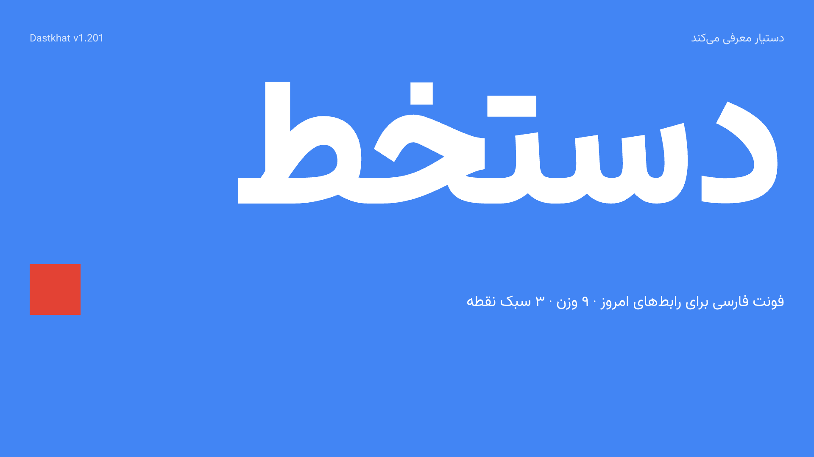
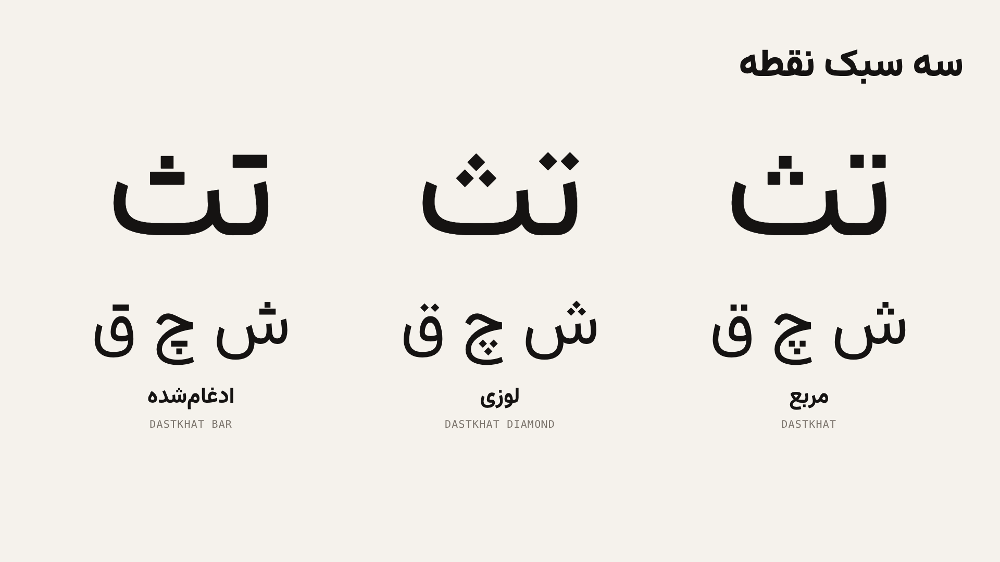
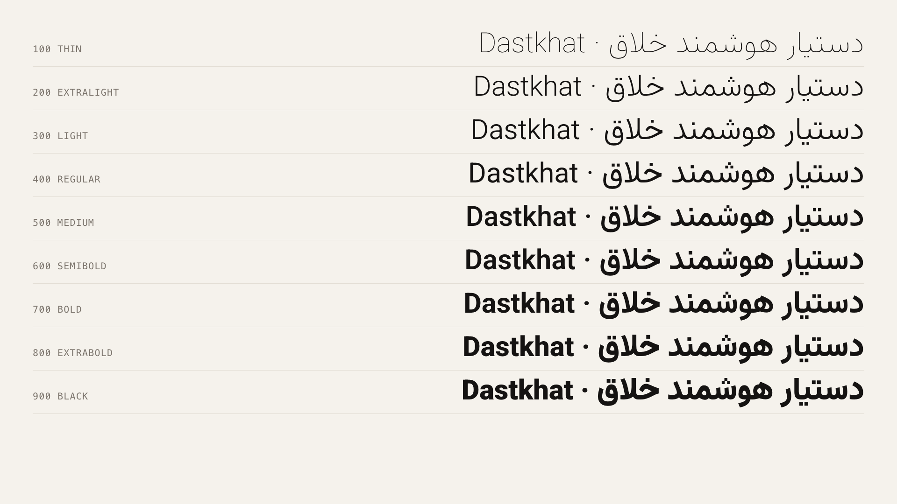
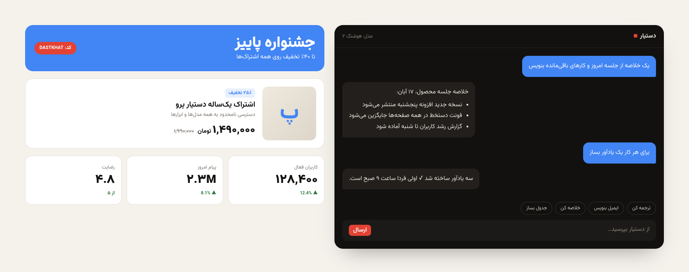

<div dir="rtl">

<div align="center">




# دستخط (Dastkhat)

**فونت فارسی و لاتین برای رابط کاربری، با نقطه‌های هندسی.**

[](FONTLOG.txt)
[](OFL.txt)
[](#محتویات-بسته)

**فارسی** · [English](README.en.md)

</div>

---

دستخط برای رابط کاربری محصولات، فروشگاه‌های اینترنتی و متن‌های فارسی پرحجم روی صفحه طراحی شده است. این فونت در ۹ وزن (از Thin با وزن ۱۰۰ تا Black با وزن ۹۰۰) و یک نسخه متغیر منتشر می‌شود، در سه سبک نقطه، و برای نیازهای رایج، نسخه‌های FaNum و NoEn هم دارد.

دستخط را [دستیار](https://dastyar.io) منتشر کرده و بر پایه [وزیرمتن](https://github.com/rastikerdar/vazirmatn) ساخته شده است.

## فهرست

- [شروع سریع](#شروع-سریع)
- [کدام نسخه را انتخاب کنم؟](#کدام-نسخه-را-انتخاب-کنم)
- [محتویات بسته](#محتویات-بسته)
- [نصب](#نصب)
- [استفاده در وب](#استفاده-در-وب)
- [نکات تایپوگرافی](#نکات-تایپوگرافی)
- [مجوز استفاده](#مجوز-استفاده)
- [سازندگان](#سازندگان)

## شروع سریع

برای وب‌سایت، پوشه `Webfonts` را در پروژه کپی کنید و این چند خط را اضافه کنید:

```html
<link rel="stylesheet" href="/Webfonts/dastkhat.css">
<style>
  body { font-family: var(--font-dastkhat); }
</style>
```

برای نرم‌افزارهای طراحی مثل فیگما، فتوشاپ و ایلاستریتور، فایل‌های TTF پوشه `fonts/Main/Dastkhat/TTF` را نصب کنید. جزئیات در بخش [نصب](#نصب) آمده است.

## کدام نسخه را انتخاب کنم؟

### سبک‌های نقطه

| خانواده | نقطه‌ها | کاربرد پیشنهادی |
|---|---|---|
| **Dastkhat** | مربع | پیش‌فرض برای رابط کاربری و متن |
| **Dastkhat Diamond** | مربع چرخیده ۴۵ درجه (لوزی) | ظاهر نرم‌تر و کلاسیک |
| **Dastkhat Bar** | دو نقطه یک خط می‌شود، سه نقطه یک خط و یک مربع | لوگو، تیتر و هویت بصری |
| **Dastkhat Dots** | دایره | همان هندسه با بافتی نرم‌تر و گردتر |
| **Dastkhat BarDots** | دو نقطه یک کپسول می‌شود، سه نقطه یک کپسول و یک دایره | لوگو و تیتر با ظاهر گرد |



### نسخه‌ها

هر خانواده در سه نسخه ارائه می‌شود.

| نسخه | تفاوت | چه زمانی استفاده کنم؟ |
|---|---|---|
| **Main** | فارسی و لاتین کامل | بیشتر پروژه‌ها |
| **FaNum** | عددهای لاتین `0-9` با شکل فارسی `۰-۹` نمایش داده می‌شوند | قیمت، جدول و داشبورد. داده و کد شما تغییری نمی‌کند. |
| **NoEn** | حروف لاتین حذف شده‌اند | می‌خواهید دستخط را با فونت لاتین دلخواه خودتان (مثل Inter یا Geist) ترکیب کنید |

### ثابت یا متغیر؟

| نیاز شما | پوشه پیشنهادی |
|---|---|
| کنترل دقیق هر وزن در نرم‌افزار طراحی | `fonts/Main/<Family>/TTF` (۹ وزن) |
| حجم کمتر و همه وزن‌های ۱۰۰ تا ۹۰۰ در یک فایل | `fonts/Main/<Family>/Variable` |
| وب‌سایت و اپلیکیشن وب | `Webfonts/` (فرمت WOFF2) |

## محتویات بسته

```
Dastkhat-v1.210/
├── fonts/
│   ├── Main/      Dastkhat, DastkhatDiamond, DastkhatBar,
│   │              DastkhatDots, DastkhatBarDots           (۹ وزن TTF + Variable)
│   ├── FaNum/     همان خانواده‌ها، با عددهای فارسی
│   └── NoEn/      همان خانواده‌ها، فقط فارسی
├── Webfonts/      dastkhat.css, fonts/*.woff2, webfont-test.html
├── Specimen/      Dastkhat-Specimen.pdf
├── Demos/         صفحه معرفی، تست‌کننده متن، نقشه حروف، نمونه رابط کاربری، تصاویر
├── Helps/         راهنمای نصب و استفاده (فارسی و انگلیسی)
├── OFL.txt        مجوز SIL Open Font License 1.1
├── License/       اطلاعیه اجزای دیگران
├── sources/        اسکریپت‌های ساخت
├── FONTLOG.txt    تاریخچه تغییرات
├── README.md      همین فایل
└── README.en.md   راهنمای انگلیسی
```

## نصب

> [!IMPORTANT]
> روی هر سیستم **یا** نسخه ثابت را نصب کنید **یا** نسخه متغیر را، نه هر دو را. نام‌های یکسان در بسیاری از نرم‌افزارها تداخل ایجاد می‌کند.

### ویندوز

۱. پوشه `fonts/Main/Dastkhat/TTF` را باز کنید.
۲. همه فایل‌ها را انتخاب کنید (`Ctrl+A`)، راست‌کلیک کنید و گزینه **Install for all users** را بزنید.
۳. نرم‌افزار طراحی را یک بار ببندید و دوباره باز کنید.

### مک

۱. برنامه **Font Book** را باز کنید.
۲. فایل‌های TTF را به داخل پنجره بکشید.
۳. اگر هشدار تکراری بودن دیدید، ابتدا نسخه قبلی دستخط را حذف کنید.

### لینوکس

```bash
mkdir -p ~/.local/share/fonts/Dastkhat
cp fonts/Main/Dastkhat/TTF/*.ttf ~/.local/share/fonts/Dastkhat/
fc-cache -f
```

## استفاده در وب

### CSS ساده

فایل CSS برای هر خانواده یک متغیر تعریف کرده است:

```css
body    { font-family: var(--font-dastkhat); }                         /* نقطه مربع */
.price  { font-family: var(--font-dastkhat-fanum); }                   /* اعداد فارسی */
.logo   { font-family: var(--font-dastkhat-bar); font-weight: 900; }   /* نقطه‌های ادغام‌شده */
```

| متغیر | خانواده |
|---|---|
| `--font-dastkhat` | Dastkhat |
| `--font-dastkhat-diamond` | Dastkhat Diamond |
| `--font-dastkhat-bar` | Dastkhat Bar |
| `--font-dastkhat-dots` | Dastkhat Dots |
| `--font-dastkhat-bardots` | Dastkhat BarDots |
| `--font-dastkhat-fanum` | Dastkhat FaNum |

نام خانواده‌های متغیر `Dastkhat`، `Dastkhat Diamond`، `Dastkhat Bar`، `Dastkhat Dots` و `Dastkhat BarDots` است (برای نسخه‌های دیگر، `FaNum` یا `NoEn` را به انتهای نام اضافه کنید). نسخه‌های ثابت همین نام‌ها را با پسوند `Static` دارند. همه قانون‌های `@font-face` از `font-display: swap` استفاده می‌کنند.

### ترکیب با فونت لاتین دیگر (NoEn)

```css
body { font-family: 'Dastkhat NoEn', 'Inter', sans-serif; }
```

دستخط NoEn حروف لاتین ندارد، پس مرورگر متن انگلیسی را با Inter نمایش می‌دهد.

### Next.js

```js
import localFont from 'next/font/local'

export const dastkhat = localFont({
  src: './Dastkhat-Variable.woff2',
  weight: '100 900',
  variable: '--font-dastkhat',
  display: 'swap',
})
```

### Tailwind CSS

در تنظیمات Tailwind، مقدار `fontFamily.sans` را برابر `var(--font-dastkhat)` قرار دهید.

### صفحه‌های راست‌به‌چپ

جهت و زبان را روی سند تعیین کنید تا علائم نگارشی و عددها درست نمایش داده شوند:

```html
<html lang="fa" dir="rtl">
```

### سرعت بارگذاری

- اگر از سه وزن یا بیشتر استفاده می‌کنید، WOFF2 متغیر را انتخاب کنید.
- فقط فایلی را پیش‌بارگذاری (preload) کنید که در بخش اول صفحه لازم است:
  ```html
  <link rel="preload" href="/Webfonts/fonts/Dastkhat-Variable.woff2" as="font" type="font/woff2" crossorigin>
  ```
- فایل‌ها را روی سرور خودتان قرار دهید و برای فونت به CDN شخص ثالث تکیه نکنید.

برای اطمینان از بارگذاری درست، فایل `Webfonts/webfont-test.html` را در مرورگر باز کنید.

## نکات تایپوگرافی

| بخش | پیشنهاد |
|---|---|
| متن بدنه | اندازه ۱۵ تا ۱۸ پیکسل، فاصله خطوط ۱٫۸ تا ۲ |
| تیتر | وزن ۷۰۰ تا ۹۰۰، فاصله خطوط ۱٫۲ تا ۱٫۳ |
| قیمت و جدول | نسخه FaNum |
| متن فارسی | **از `letter-spacing` استفاده نکنید.** اتصال حروف را می‌شکند. |

متن فارسی به‌خاطر کشیدگی بالای حروف و نقطه‌ها به فاصله خطوط بیشتری از لاتین نیاز دارد. اگر متن فشرده به نظر می‌رسد، به‌جای کوچک‌کردن اندازه، اول فاصله خطوط را زیاد کنید.

### نشانه‌های پول

ریال نشانه استاندارد دارد، `﷼` (U+FDFC)، اما تومان هیچ کدپوینتی در یونیکد ندارد: کمیته فنی یونیکد پیشنهاد سال ۲۰۱۷ را رد کرد، چون تومان همیشه به‌صورت واژه نوشته می‌شد و نشانه‌ای در عمل به کار نمی‌رفت. دستخط سه نشانه خودش را در ناحیه استفاده شخصی اضافه می‌کند، در همه خانواده‌ها و همه وزن‌ها.

| نشانه | کدپوینت | شکل |
|---|---|---|
| ریال | `U+FDFC` ﷼ | نشانه استاندارد: واژه «ریال» در یک گلیف. بدون تغییر. |
| تومان | `U+E000` | «ت» که دو نقطه‌اش به دو خط کشیده شده، مثل «=» در ₹ و € و ¥. دستخط Bar نقطه‌ها را به خط تبدیل می‌کند؛ اینجا همان خط‌ها نشانه پول می‌شوند. |
| ریال، فشرده | `U+E001` | «ا» و «ل» به‌صورت دو ستون، که «ر» از میانشان می‌گذرد. واژه به خط‌هایش خلاصه شده، همان منطق نشانه ریال سعودی. |
| تومان، روی‌هم | `U+E002` | «ن» روی «توما»، همان آیکون تومانی که سایت‌های ایرانی به کار می‌برند، با حروف دستخط. قرینه ﷼. |

دو ویژگی اختیاری OpenType واژه تایپ‌شده را به نشانه تبدیل می‌کنند، پس در محتوا و کد همان «تومان» و «ریال» را می‌نویسید. `ss02` همان مجموعه سبکی است که فونت‌های فارسی دیگر مثل راوی و ابر برای نشانه پول به کار می‌برند.

```css
.price      { font-feature-settings: 'ss02'; }   /* «تومان» و «ریال» نشانه فشرده می‌شوند */
.price-long { font-feature-settings: 'ss03'; }   /* «تومان» نشانه روی‌هم و «ریال» به ﷼ تبدیل می‌شود */
```

هیچ‌کدام به‌صورت پیش‌فرض روشن نیست، پس در بقیه متن واژه‌ها واژه می‌مانند. فقط واژه واحد پول جایگزین می‌شود و عدد کنارش دست‌نخورده باقی می‌ماند.

> [!NOTE]
> نشانه‌های فشرده در ناحیه استفاده شخصی‌اند، یعنی مخصوص دستخط‌اند: اگر فونت جایگزین بارگذاری شود، آن کدپوینت‌ها چیز درستی نشان نمی‌دهند. برای نمایش از آن‌ها استفاده کنید و هرجا متن باید کپی و جابه‌جا شود، واژه ساده را نگه دارید.

## پیش‌نمایش

| | |
|---|---|
|  |  |
| نه وزن | نمونه رابط کاربری |

نمونه‌های بیشتر را در `Demos/index.html`، تست‌کننده متن (`Demos/type-tester.html`) و نقشه حروف (`Demos/glyph-map.html`) ببینید. نمونه‌نامه کامل در `Specimen/Dastkhat-Specimen.pdf` قرار دارد.

## ساخت از روی سورس
سورس قابل ویرایش (سه مستر UFO و یک designspace برای هر سبک نقطه) در `sources/ufo/` است. برای ساخت دوباره همه فونت‌ها:

```bash
pip install fontmake fonttools brotli
sh sources/build_all.sh build
```

## مجوز استفاده

دستخط **آزاد و متن‌باز** است و با مجوز [SIL Open Font License 1.1](OFL.txt) منتشر می‌شود.

- ✅ برای هر کاری آزادانه استفاده کنید: وب، اپ، چاپ، بسته‌بندی، ویدیو، لوگو، کار مشتری و محصول تجاری
- ✅ فونت را روی سرور خودتان بگذارید، در نرم‌افزار تعبیه کنید یا همراه آن پخش کنید
- ✅ فونت را تغییر دهید و نسخه تغییریافته را با همین مجوز منتشر کنید
- ❌ خود فایل‌های فونت را به‌تنهایی نفروشید
- ❌ فونت را با مجوز دیگری منتشر نکنید

دستخط بر پایه [وزیرمتن](https://github.com/rastikerdar/vazirmatn) اثر صابر راستی‌کردار (مجوز OFL 1.1) ساخته شده است.

## مشارکت و حمایت
گزارش خطا، اصلاح حروف و پیشنهاد پشتیبانی از خط‌های جدید خوشحالمان می‌کند: [CONTRIBUTING.md](CONTRIBUTING.md). اگر دستخط برایتان مفید بود، می‌توانید از طریق [GitHub Sponsors](https://github.com/sponsors/dastyar-io) حمایت کنید.

## تاریخچه ستاره‌ها

<a href="https://www.star-history.com/?repos=dastyar-io%2Fdastkhat-font&type=timeline&releases=&legend=bottom-right">
 <picture>
   <source media="(prefers-color-scheme: dark)" srcset="https://api.star-history.com/chart?repos=dastyar-io/dastkhat-font&type=timeline&theme=dark&logscale&legend=bottom-right" />
   <source media="(prefers-color-scheme: light)" srcset="https://api.star-history.com/chart?repos=dastyar-io/dastkhat-font&type=timeline&logscale&legend=bottom-right" />
   
 </picture>
</a>

© 2026 مشارکت‌کنندگان دستخط · منتشرشده توسط دستیار

## سازندگان

- **دستیار** ([dastyar.io](https://dastyar.io)): سبک‌های نقطه، تغییرات و انتشار.
- **صابر راستی‌کردار**: طراح [وزیرمتن](https://github.com/rastikerdar/vazirmatn) که پایه دستخط است و با اجازه ایشان استفاده شده است.
- حروف لاتین از Roboto (مجوز Apache 2.0) گرفته شده است.

تاریخچه کامل تغییرات در [FONTLOG.txt](FONTLOG.txt) آمده است.

---

<div align="center">

© ۱۴۰۵ دستیار · [dastyar.io](https://dastyar.io)

</div>

</div>
