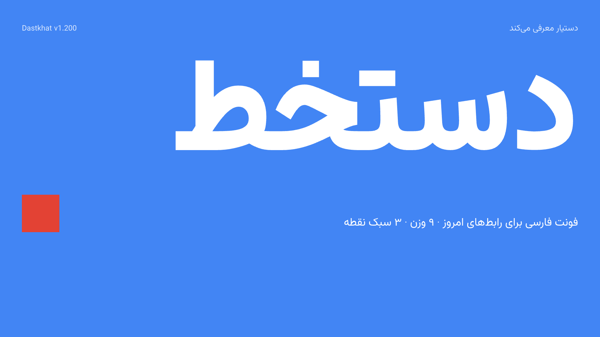
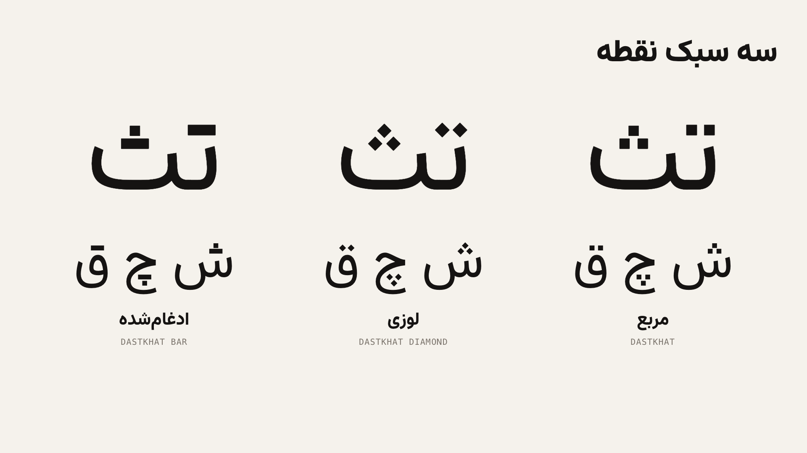
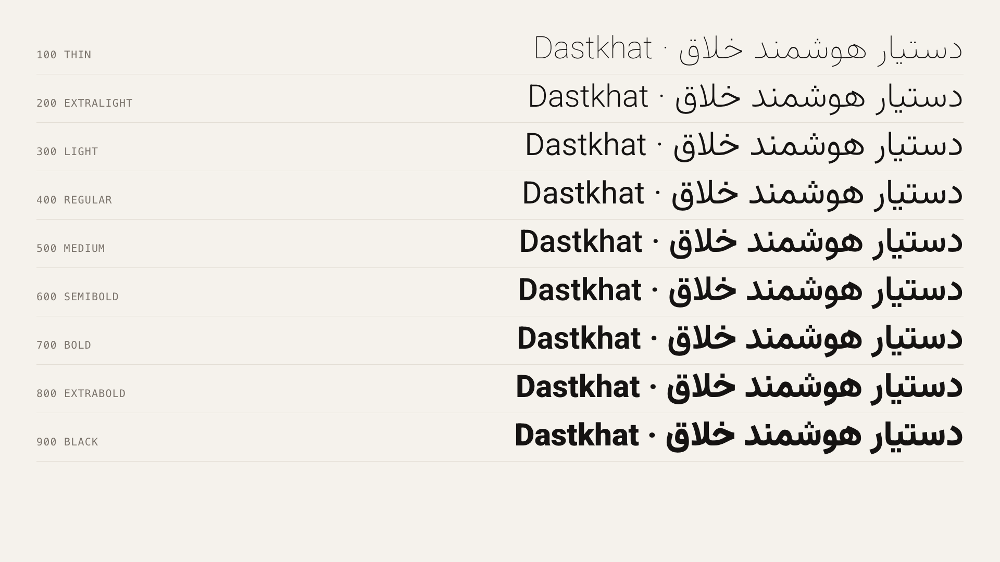
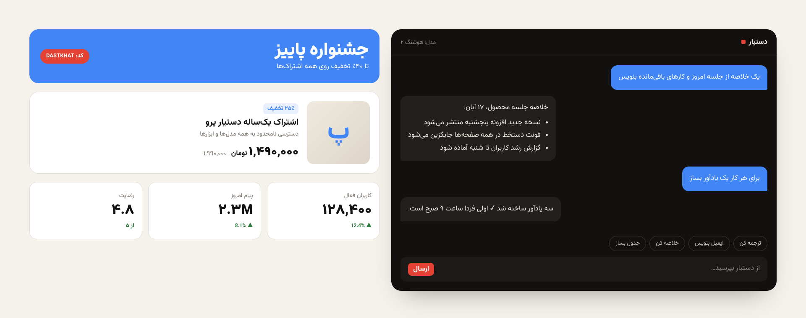

<div align="center">



# Dastkhat (دستخط)

**A Persian and Latin UI typeface with geometric dots.**

[](FONTLOG.txt)
[](License/EULA.txt)
[](#whats-in-the-package)

**English** · [فارسی](README.fa.md)

</div>

---

Dastkhat is built for product interfaces, e-commerce pages and dense Persian text on screens. It comes in 9 weights (Thin 100 to Black 900) plus a variable font, in three dot styles, with FaNum and NoEn builds for common real-world setups.

It is published by [Dastyar](https://dastyar.io) and is a derivative of [Vazirmatn](https://github.com/rastikerdar/vazirmatn).

## Contents

- [Quick start](#quick-start)
- [Which one should I use?](#which-one-should-i-use)
- [What's in the package](#whats-in-the-package)
- [Installation](#installation)
- [Usage on the web](#usage-on-the-web)
- [Typography tips](#typography-tips)
- [License](#license)
- [Credits](#credits)

## Quick start

For a website, copy the `Webfonts` folder into your project and add three lines:

```html
<link rel="stylesheet" href="/Webfonts/dastkhat.css">
<style>
  body { font-family: var(--font-dastkhat); }
</style>
```

For a design tool such as Figma, Photoshop or Illustrator, install the TTF files from `Fonts/Main/Dastkhat/TTF`. See [Installation](#installation).

## Which one should I use?

### Dot styles

| Family | Dots | Best for |
|---|---|---|
| **Dastkhat** | Square | Default for interfaces and body text |
| **Dastkhat Diamond** | Square rotated 45° | A softer, more classic look |
| **Dastkhat Bar** | Two dots merge into a bar, three into a bar and a square | Logos, headlines and brand marks |



### Builds

Every family is available in three builds.

| Build | What changes | Use it when |
|---|---|---|
| **Main** | Full Persian and Latin | Most projects |
| **FaNum** | Latin digits `0-9` display as Persian digits `۰-۹` | Prices, tables and dashboards. Your data and code stay unchanged. |
| **NoEn** | Latin letters removed | You want to pair Dastkhat with your own Latin font, such as Inter or Geist |

### Static or variable?

| Need | Use |
|---|---|
| Precise control over each weight in design tools | `Fonts/Main/<Family>/TTF` (9 weights) |
| Smaller files, every weight from 100 to 900 in one file | `Fonts/Main/<Family>/Variable` |
| Websites and web apps | `Webfonts/` (WOFF2) |

## What's in the package

```
Dastkhat-v1.200/
├── Fonts/
│   ├── Main/      Dastkhat, DastkhatDiamond, DastkhatBar   (TTF ×9 + Variable)
│   ├── FaNum/     Same families, Latin digits shown as Persian digits
│   └── NoEn/      Same families, Persian only
├── Webfonts/      dastkhat.css, fonts/*.woff2, webfont-test.html
├── Specimen/      Dastkhat-Specimen.pdf
├── Demos/         Font page, type tester, glyph map, UI demos, images
├── Helps/         Installation and usage guide (Persian and English)
├── License/       EULA, third-party notices and a license summary (PDF)
├── Source/        Build scripts
├── FONTLOG.txt    Change history
├── README.md      This file
└── README.fa.md   Persian version of this file
```

## Installation

> [!IMPORTANT]
> On one computer, install **either** the static fonts **or** the variable font, never both. Identical family names cause conflicts in many apps.

### Windows

1. Open `Fonts/Main/Dastkhat/TTF`.
2. Select all files (`Ctrl+A`), right-click and choose **Install for all users**.
3. Restart your design software.

### macOS

1. Open **Font Book**.
2. Drag the TTF files into the window.
3. If you see a duplicate warning, remove the previous Dastkhat version first.

### Linux

```bash
mkdir -p ~/.local/share/fonts/Dastkhat
cp Fonts/Main/Dastkhat/TTF/*.ttf ~/.local/share/fonts/Dastkhat/
fc-cache -f
```

## Usage on the web

### Plain CSS

The stylesheet defines one variable per family:

```css
body    { font-family: var(--font-dastkhat); }                         /* square dots */
.price  { font-family: var(--font-dastkhat-fanum); }                   /* Persian digits */
.logo   { font-family: var(--font-dastkhat-bar); font-weight: 900; }   /* merged dots */
```

| Variable | Family |
|---|---|
| `--font-dastkhat` | Dastkhat |
| `--font-dastkhat-diamond` | Dastkhat Diamond |
| `--font-dastkhat-bar` | Dastkhat Bar |
| `--font-dastkhat-fanum` | Dastkhat FaNum |

The variable families are named `Dastkhat`, `Dastkhat Diamond` and `Dastkhat Bar` (add ` FaNum` or ` NoEn` for the other builds). The static fallbacks use the same names with ` Static` added. All `@font-face` rules use `font-display: swap`.

### With a separate Latin font (NoEn)

```css
body { font-family: 'Dastkhat NoEn', 'Inter', sans-serif; }
```

The browser finds no Latin letters in Dastkhat NoEn and falls through to Inter for English text.

### Next.js

```js
import localFont from 'next/font/local'

export const dastkhat = localFont({
  src: './Dastkhat-Variable.woff2',
  weight: '100 900',
  variable: '--font-dastkhat',
  display: 'swap',
})
```

### Tailwind CSS

Set `fontFamily.sans` to `var(--font-dastkhat)` in your Tailwind config.

### Right-to-left pages

Set the direction and language on the document so punctuation and numbers behave correctly:

```html
<html lang="fa" dir="rtl">
```

### Performance

- Prefer the variable WOFF2 when you use three or more weights.
- Preload only the file used above the fold:
  ```html
  <link rel="preload" href="/Webfonts/fonts/Dastkhat-Variable.woff2" as="font" type="font/woff2" crossorigin>
  ```
- Self-host the files. Do not rely on a third-party CDN for fonts.

Open `Webfonts/webfont-test.html` in a browser to confirm everything loads.

## Typography tips

| Element | Recommendation |
|---|---|
| Body text | 15 to 18 px, line height 1.8 to 2 |
| Headings | Weight 700 to 900, line height 1.2 to 1.3 |
| Prices and tables | Use the FaNum build |
| Persian text | **Do not use `letter-spacing`.** It breaks the joining of letters. |

Persian needs more line height than Latin because of its tall ascenders and stacked dots. If your text looks cramped, increase line height before reducing font size.

## Preview

| | |
|---|---|
|  |  |
| Nine weights | Interface example |

Explore more in `Demos/index.html`, the type tester (`Demos/type-tester.html`) and the glyph map (`Demos/glyph-map.html`). The full specimen is in `Specimen/Dastkhat-Specimen.pdf`.

## License
Dastkhat is **commercial software**, sold under the Dastkhat End User License Agreement (see `License/EULA.txt`). Buy a license at https://dastyar.io.

| License | What it covers |
|---|---|
| **Desktop** | Install on the number of computers on your receipt. Print, packaging, video, images, PDFs, logos |
| **Web** | Self-host the WOFF2 files on your listed domains, up to the monthly page views on your receipt |
| **App / Software** | Embed in one named application or product |

- ❌ Don't copy, share, resell or redistribute the font files, or upload them to public sites or repositories
- ❌ Don't modify the font or make derivative fonts
- ✅ Logos and artwork converted to outlines or images can be used without limit
- ✅ Client work needs the client's own license, or delivery as outlines/images only

Dastkhat is a derivative of [Vazirmatn](https://github.com/rastikerdar/vazirmatn) by Saber Rastikerdar, used with his permission. The Latin glyphs derive from Roboto (Apache 2.0). See `License/THIRD-PARTY-NOTICES.txt`. Copies of v1.200 and earlier that were published under the SIL OFL 1.1 stay under that license for the people who received them.

© 2026 Dastyar · https://dastyar.io
